<picture>
  <source media="(max-width: 900px) and (prefers-color-scheme: dark)" srcset="./assets/zirtuno-liquid-dark-mobile.svg">
  <source media="(max-width: 900px)" srcset="./assets/zirtuno-liquid-light-mobile.svg">
  <source media="(prefers-color-scheme: dark)" srcset="./assets/zirtuno-liquid-dark.svg">
  
</picture>

I co-founded Zirtuno. I build WebGL graphics for our site, connect ERP systems to CRMs, and write C and C++ tools for industrial hardware.

### Selected work

- **[Smart Parking](https://github.com/Pedrowtst/smart-parking-esp32)** · A university project that uses an ESP32-CAM and a laptop to count vehicles entering and leaving a parking lot.
- **[Zirtuno Sync Yampi](https://github.com/ZIRTUNO/zirtuno-sync-yampi)** · A Chrome extension for editing store themes locally and reviewing changes before uploading them to Yampi.
- **[CoverBatch Studio](https://github.com/ZIRTUNO/coverbatch-studio)** · A desktop tool for adding platform badges and store logos to a batch of game covers.

[Zirtuno](https://zirtuno.com) · [GitHub organization](https://github.com/ZIRTUNO) · [LinkedIn](https://www.linkedin.com/in/pedro-mautone/) · [Email](mailto:pedropaivamautone@gmail.com)
